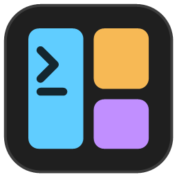

<p align="center">
  
</p>

# TerminalTabConfigurator

[English](README.md) · **Français**

Petit utilitaire Windows (WPF, .NET 10) pour **dessiner graphiquement un onglet Windows Terminal divisé en volets**, puis l'ajouter à Windows Terminal. Chaque volet a sa propre commande, son profil, son dossier de démarrage et son titre.

Exemple : un onglet divisé verticalement, dont la moitié droite est elle-même divisée horizontalement, avec `pwsh.exe` lancé dans un dossier différent pour chaque volet. Une fois publiée, la disposition s'ouvre en un clic depuis la palette de commandes, le menu « Nouvel onglet », un raccourci clavier ou un raccourci sur le Bureau.

## Fonctionnalités

- **Éditeur visuel** : division verticale ou horizontale d'un volet (barre d'outils, boutons du volet, clic droit), suppression, égalisation, redimensionnement à la souris (le pourcentage s'affiche sur chaque séparateur).
- **Modèles de départ** : volet unique, 2 colonnes, 2 lignes, 1 + 2 à droite, 2 à gauche + 1, 1 en haut + 2 en bas, 3 colonnes, grille 2 × 2.
- **Par volet** : titre, profil Windows Terminal, ligne de commande, dossier de démarrage, taille, volet qui a le focus à l'ouverture.
- **Par onglet** : nom (affiché dans la palette et le menu), icône, titre de l'onglet, couleur de l'onglet.
- **Publication dans `settings.json`**, avec un aperçu exact du JSON écrit, une sauvegarde horodatée et une détection des conflits de raccourcis clavier.
- **Relecture et modification** des dispositions déjà publiées : elles sont relues depuis `settings.json` au démarrage.
- **Tester** : ouvre la disposition tout de suite dans Windows Terminal, sans rien publier.
- **Commande générée** : la ligne `wt.exe` équivalente, à copier dans un script.
- Prise en charge de Windows Terminal, Windows Terminal Preview, Canary et de la version non empaquetée (choix de l'installation dans la barre d'outils).
- **Interface en français ou en anglais**, alignée par défaut sur la langue d'affichage de Windows.
- **Thème sombre ou clair**, aligné par défaut sur le mode des applications Windows.

## Téléchargement

Chaque [release](https://github.com/ddcdk/TerminalTabConfigurator/releases) contient une version autonome (self-contained) pour Windows x64 : décompressez-la et lancez `TerminalTabConfigurator.exe`. Aucune installation de .NET n'est nécessaire.

## Prérequis

- Windows 10 ou 11 avec une version récente de [Windows Terminal](https://aka.ms/terminal) (testé avec la 1.24).
- [SDK .NET 10](https://dotnet.microsoft.com/download) pour compiler depuis les sources.

## Compiler et lancer

```powershell
dotnet build
dotnet run --project src/TerminalTabConfigurator
```

Tests unitaires de la bibliothèque `Core` (génération, relecture, titres, icônes, élévation) :

```powershell
dotnet test
```

## Utilisation

1. **Nouvelle** : choisissez un modèle, un nom, un profil et un dossier par défaut.
2. Cliquez un volet pour le sélectionner, divisez-le ou supprimez-le, et glissez les séparateurs pour ajuster les tailles.
3. Renseignez les propriétés du volet sélectionné et de l'onglet dans le panneau de droite.
4. **Tester** pour vérifier le rendu dans Windows Terminal.
5. **Ajouter à Windows Terminal…** : choisissez où l'ajouter (palette, raccourci clavier, menu « Nouvel onglet », profil, raccourci Bureau), vérifiez le JSON, puis publiez.

Windows Terminal recharge `settings.json` tout seul : la disposition est disponible immédiatement. Pour la modifier plus tard, sélectionnez-la dans **Mes dispositions**, changez-la, puis publiez à nouveau (l'entrée existante est mise à jour). **Retirer / supprimer** l'enlève de `settings.json`.

### Créer aussi un profil

Une action ne peut pas être le profil par défaut de Windows Terminal, ni être lancée avec `wt -p`. L'option **Créer aussi un profil** ajoute un profil du nom de la disposition, dont la ligne de commande est la commande `wt.exe -w 0 nt … ; sp … ; fp …` équivalente :

- avec **Menu « Nouvel onglet »** coché, le menu affiche le profil à la place de l'action : la disposition n'y apparaît qu'une fois ;
- menu décoché, le profil est masqué (`"hidden": true`) : il n'apparaît plus dans le menu mais reste utilisable avec `wt -p "<nom>"` ;
- dans les deux cas, l'action reste dans la palette de commandes et garde son raccourci clavier.

Le profil est mis à jour à chaque publication (nom, ligne de commande, icône) ; les réglages que vous lui ajoutez à la main dans Windows Terminal (couleurs, police…) sont conservés. Il est supprimé quand l'option est décochée ou que la disposition est retirée, sauf s'il est le profil par défaut : choisissez d'abord un autre profil par défaut. Les profils qui ouvrent une disposition ne sont pas proposés dans la liste des profils des volets.

### Importer un profil

Un profil dont la ligne de commande lance `wt.exe` (par exemple `wt.exe -w 0 nt -p … ; sp -V -s 0.4 … ; fp -t 0`, comme la commande générée recopiée dans un profil) peut être retransformé en disposition : **Importer** liste ces profils, et en choisir un crée une nouvelle disposition non publiée avec ses volets, titres, dossiers, tailles, couleur d'onglet et icône. Le profil lui-même n'est pas modifié ; une fois la disposition publiée (avec **Créer aussi un profil** si vous en avez besoin), vous pouvez supprimer le profil d'origine dans Windows Terminal. Les profils créés par l'outil ne sont pas listés.

### Langue et thème

Le bouton en forme d'engrenage, à droite de la barre d'outils, ouvre les préférences :

- **Langue** : langue du système (français si Windows est en français, anglais sinon), Français ou English ;
- **Thème** : thème du système, Sombre ou Clair.

Les changements s'appliquent immédiatement et sont enregistrés dans `%APPDATA%\TerminalTabConfigurator\preferences.json`.

### Titres

- Le **titre d'un volet** (y compris le premier) est le titre de ce volet. Vide : le volet affiche le titre de son processus.
- Le **titre de l'onglet** est indépendant des volets ; il est appliqué en dernier. Vide : l'onglet affiche le titre du volet actif, comme d'habitude dans Windows Terminal.

### Icône

L'icône s'affiche dans la palette de commandes et dans le menu « Nouvel onglet ». Elle peut être :

- un **emoji** (suggestions proposées dans l'éditeur, ou saisie libre) ;
- un **glyphe** de la police Segoe Fluent Icons ;
- un **fichier image** (`.png`, `.ico`, `.jpg`…), choisi avec le bouton Parcourir ; les variables d'environnement sont acceptées (`%USERPROFILE%\icons\api.png`).

Un fichier `.ico` sert aussi d'icône au raccourci du Bureau. Sinon, le raccourci prend l'icône de Windows Terminal.

> Dans l'éditeur, les emoji sont affichés en monochrome (limite de WPF) ; Windows Terminal les affiche en couleur.

## Ce qui est écrit dans `settings.json`

Chaque disposition est une **action** (identifiant `User.TTC.<nom>`) de type `multipleActions`, qui rejoue la construction de l'onglet : `newTab`, puis un `splitPane` par division (avec `focusPane` quand il faut revenir sur un volet précédent), puis `renameTab` pour le titre de l'onglet.

```jsonc
"actions": [
    {
        "id": "User.TTC.DevWeb",
        "name": "Dev Web",
        "icon": "🚀",
        "command": {
            "action": "multipleActions",
            "actions": [
                { "action": "newTab", "commandline": "pwsh.exe", "startingDirectory": "C:\\Dev\\webapp\\front", "tabTitle": "Front", "tabColor": "#C18FFF" },
                { "action": "splitPane", "split": "right", "size": 0.5, "commandline": "pwsh.exe", "startingDirectory": "C:\\Dev\\webapp\\api", "tabTitle": "API" },
                { "action": "splitPane", "split": "down", "size": 0.4, "commandline": "pwsh.exe", "startingDirectory": "C:\\Dev\\webapp\\logs", "tabTitle": "Logs" },
                { "action": "renameTab", "title": "Dev Web" }
            ]
        }
    }
],
"keybindings": [ { "id": "User.TTC.DevWeb", "keys": "ctrl+alt+d" } ],
"newTabMenu": [ { "type": "action", "id": "User.TTC.DevWeb" }, { "type": "remainingProfiles" } ]
```

- Le raccourci clavier et l'entrée du menu « Nouvel onglet » sont facultatifs. Ils référencent l'action par son identifiant ; le menu reprend son nom et son icône.
- Avant chaque écriture, une copie `settings.json.ttc-backup-AAAAMMJJ-HHMMSS` est faite à côté du fichier (option cochée par défaut).
- Le raccourci du Bureau lance `wt.exe -w 0 nt … ; sp … ; fp …` (dernière fenêtre Windows Terminal utilisée).

## Profils administrateur

Windows Terminal ne peut pas ouvrir un volet administrateur (`"elevate": true`) dans une fenêtre normale : il ouvre une autre fenêtre avec un seul volet, et la division est perdue. L'outil en tient compte :

- **tous les volets sont administrateur** : *Tester* demande l'élévation, et le raccourci du Bureau est marqué « Exécuter en tant qu'administrateur ». Le menu, la palette et le raccourci clavier ne fonctionnent que dans une fenêtre Windows Terminal déjà lancée en administrateur ;
- **mélange de volets normaux et administrateur** : impossible dans un même onglet ; la publication et le test sont bloqués, avec un message explicatif.

Les profils administrateur sont signalés « (admin) » dans la liste des profils.

## Limites connues

- Les **commentaires** de `settings.json` ne sont pas conservés à l'écriture (d'où la sauvegarde automatique).
- Les dispositions non publiées ne sont pas enregistrées : fermez l'outil après avoir publié, ou confirmez la perte des modifications.
- La ligne de commande `wt.exe` n'a pas d'équivalent à `renameTab` : dans la commande générée et le raccourci du Bureau, les volets sans titre prennent le titre de l'onglet.
- Les dispositions publiées avec une version antérieure de l'outil (sans `renameTab`) sont relues correctement ; republiez-les pour passer au nouveau format des titres.
- Une action modifiée à la main avec des étapes non prises en charge (par exemple `moveFocus`) est listée avec un message d'erreur et n'est pas éditable.

## Structure du projet

```
TerminalTabConfigurator.slnx
src/
  TerminalTabConfigurator.Core/        Bibliothèque sans dépendance à WPF
    Model/        Arbre de disposition : TabLayout, SplitNode, PaneLeaf
    Templates/    Modèles de départ
    Generation/   Étapes newTab / splitPane / focusPane, JSON des actions, ligne de commande wt.exe
    Parsing/      Relecture d'une action multipleActions en arbre de volets
    Settings/     Lecture/écriture de settings.json, installations détectées, analyse de l'élévation
  TerminalTabConfigurator/             Application WPF (thème Fluent, MVVM)
    Controls/     LayoutCanvas : aperçu interactif des volets
    Dialogs/      Nouvelle disposition, Ajouter à Windows Terminal
    Localization/ Textes français et anglais, extension XAML {l:Tr}
    Themes/       Palettes sombre et claire
    ViewModels/   MainViewModel, LayoutEntry
    Services/     Raccourcis du Bureau, préférences, changement de thème
    Assets/       Icône de l'application
tests/
  TerminalTabConfigurator.Core.Tests/  Tests xUnit
```

## Licence

Copyright (C) 2026 Delfim Da Costa

TerminalTabConfigurator est un logiciel libre : vous pouvez le redistribuer et/ou le modifier selon les termes de la [licence publique générale GNU](LICENSE) (GNU GPL) telle que publiée par la Free Software Foundation, soit la version 3 de la licence, soit (à votre choix) toute version ultérieure.

En résumé : vous pouvez utiliser, étudier, modifier et redistribuer ce logiciel, à condition de conserver le nom de l'auteur et la licence, et de publier toute version modifiée que vous distribuez sous la même licence, avec son code source.

Ce programme est distribué dans l'espoir qu'il sera utile, mais SANS AUCUNE GARANTIE, sans même la garantie implicite de QUALITÉ MARCHANDE ou d'ADÉQUATION À UN USAGE PARTICULIER. Le texte officiel (en anglais) figure dans le fichier [LICENSE](LICENSE).
