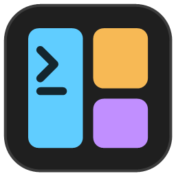

<p align="center">
  
</p>

# TerminalTabConfigurator

**English** · [Français](README.fr.md)

A small Windows utility (WPF, .NET 10) to **graphically design a Windows Terminal tab split into panes**, then add it to Windows Terminal. Each pane has its own command, profile, starting directory and title.

Example: a tab split vertically, with its right half split horizontally, each pane running `pwsh.exe` in a different folder. Once published, the layout opens in one click from the command palette, the "New tab" menu, a keyboard shortcut or a desktop shortcut.

## Features

- **Visual editor**: split a pane vertically or horizontally (toolbar, pane buttons, right-click), delete, equalize, resize with the mouse (the percentage is shown on each splitter).
- **Starting templates**: single pane, 2 columns, 2 rows, 1 + 2 on the right, 2 on the left + 1, 1 on top + 2 below, 3 columns, 2 × 2 grid.
- **Per pane**: title, Windows Terminal profile, command line, starting directory, size, which pane has focus when the tab opens.
- **Per tab**: name (shown in the palette and the menu), icon, tab title, tab color.
- **Publishing to `settings.json`**, with an exact preview of the JSON written, a timestamped backup, and detection of keyboard shortcut conflicts.
- **Reading back and editing** layouts already published: they are loaded from `settings.json` at startup.
- **Test**: opens the layout right away in Windows Terminal, without publishing anything.
- **Generated command**: the equivalent `wt.exe` command line, ready to copy into a script.
- Supports Windows Terminal, Windows Terminal Preview, Canary and the unpackaged version (installation picker in the toolbar).
- **English or French interface**, following the Windows display language by default.
- **Dark or light theme**, following the Windows app mode by default.

## Download

Each [release](https://github.com/ddcdk/TerminalTabConfigurator/releases) has a self-contained build for Windows x64: unzip it and run `TerminalTabConfigurator.exe`. No .NET installation is needed.

## Requirements

- Windows 10 or 11 with a recent version of [Windows Terminal](https://aka.ms/terminal) (tested with 1.24).
- [.NET 10 SDK](https://dotnet.microsoft.com/download) to build from source.

## Build and run

```powershell
dotnet build
dotnet run --project src/TerminalTabConfigurator
```

Unit tests for the `Core` library (generation, reading back, titles, icons, elevation):

```powershell
dotnet test
```

## Usage

1. **New**: pick a template, a name, a profile and a default folder.
2. Click a pane to select it, split or delete it, and drag the splitters to adjust sizes.
3. Fill in the properties of the selected pane and of the tab in the right-hand panel.
4. **Test** to check the result in Windows Terminal.
5. **Add to Windows Terminal…**: choose where to add it (palette, keyboard shortcut, "New tab" menu, desktop shortcut), review the JSON, then publish.

Windows Terminal reloads `settings.json` on its own, so the layout is available immediately. To change it later, select it under **My layouts**, edit it, then publish again: the existing entry is updated. **Remove / delete** removes it from `settings.json`.

### Language and theme

The gear button at the right of the toolbar opens the preferences:

- **Language**: system language (French when Windows displays French, English otherwise), Français or English;
- **Theme**: system theme, Dark or Light.

Changes apply immediately and are saved in `%APPDATA%\TerminalTabConfigurator\preferences.json`.

### Titles

- A **pane title** (including the first pane) is the title of that pane. Empty: the pane shows its process title.
- The **tab title** is independent of the panes and is applied last. Empty: the tab shows the title of the active pane, as Windows Terminal normally does.

### Icon

The icon is shown in the command palette and in the "New tab" menu. It can be:

- an **emoji** (suggestions offered in the editor, or type your own);
- a **glyph** from the Segoe Fluent Icons font;
- an **image file** (`.png`, `.ico`, `.jpg`…), picked with the Browse button; environment variables are allowed (`%USERPROFILE%\icons\api.png`).

An `.ico` file is also used as the desktop shortcut icon. Otherwise the shortcut uses the Windows Terminal icon.

> In the editor, emoji are rendered in monochrome (a WPF limitation); Windows Terminal shows them in color.

## What is written to `settings.json`

Each layout is an **action** (id `User.TTC.<name>`) of type `multipleActions` that replays how the tab is built: `newTab`, then one `splitPane` per split (with `focusPane` when it must go back to an earlier pane), then `renameTab` for the tab title.

```jsonc
"actions": [
    {
        "id": "User.TTC.DevWeb",
        "name": "Dev Web",
        "icon": "🚀",
        "command": {
            "action": "multipleActions",
            "actions": [
                { "action": "newTab", "commandline": "pwsh.exe", "startingDirectory": "C:\\Dev\\webapp\\front", "tabTitle": "Front", "tabColor": "#C18FFF" },
                { "action": "splitPane", "split": "right", "size": 0.5, "commandline": "pwsh.exe", "startingDirectory": "C:\\Dev\\webapp\\api", "tabTitle": "API" },
                { "action": "splitPane", "split": "down", "size": 0.4, "commandline": "pwsh.exe", "startingDirectory": "C:\\Dev\\webapp\\logs", "tabTitle": "Logs" },
                { "action": "renameTab", "title": "Dev Web" }
            ]
        }
    }
],
"keybindings": [ { "id": "User.TTC.DevWeb", "keys": "ctrl+alt+d" } ],
"newTabMenu": [ { "type": "action", "id": "User.TTC.DevWeb" }, { "type": "remainingProfiles" } ]
```

- The keyboard shortcut and the "New tab" menu entry are optional. They refer to the action by its id; the menu reuses its name and icon.
- Before each write, a copy named `settings.json.ttc-backup-YYYYMMDD-HHMMSS` is made next to the file (option checked by default).
- The desktop shortcut runs `wt.exe -w 0 nt … ; sp … ; fp …` (in the most recently used Windows Terminal window).

## Administrator profiles

Windows Terminal cannot open an administrator pane (`"elevate": true`) inside a normal window: it opens another window with a single pane, and the split is lost. The tool handles this:

- **all panes are administrator**: Test asks for elevation, and the desktop shortcut is marked "Run as administrator". The menu, the palette and the keyboard shortcut only work in a Windows Terminal window already running as administrator;
- **a mix of normal and administrator panes**: not possible in a single tab; publishing and testing are blocked, with an explanation.

Administrator profiles are flagged "(admin)" in the profile list.

## Known limitations

- **Comments** in `settings.json` are not kept when it is written (hence the automatic backup).
- Unpublished layouts are not saved: publish before closing the tool, or confirm that changes will be lost.
- The `wt.exe` command line has no equivalent of `renameTab`: in the generated command and the desktop shortcut, untitled panes take the tab title.
- Layouts published by an earlier version of the tool (without `renameTab`) are read back correctly; publish them again to switch to the new title format.
- An action edited by hand with unsupported steps (for example `moveFocus`) is listed with an error message and cannot be edited.

## Project structure

```
TerminalTabConfigurator.slnx
src/
  TerminalTabConfigurator.Core/        Library with no WPF dependency
    Model/        Layout tree: TabLayout, SplitNode, PaneLeaf
    Templates/    Starting templates
    Generation/   newTab / splitPane / focusPane steps, action JSON, wt.exe command line
    Parsing/      Reads a multipleActions action back into a pane tree
    Settings/     settings.json read/write, detected installations, elevation analysis
  TerminalTabConfigurator/             WPF application (Fluent theme, MVVM)
    Controls/     LayoutCanvas: interactive pane preview
    Dialogs/      New layout, Add to Windows Terminal
    Localization/ French and English texts, {l:Tr} markup extension
    Themes/       Dark and light palettes
    ViewModels/   MainViewModel, LayoutEntry
    Services/     Desktop shortcuts, preferences, theme switching
    Assets/       Application icon
tests/
  TerminalTabConfigurator.Core.Tests/  xUnit tests
```

## License

Copyright (C) 2026 Delfim Da Costa

TerminalTabConfigurator is free software: you can redistribute it and/or modify it under the terms of the [GNU General Public License](LICENSE) as published by the Free Software Foundation, either version 3 of the License, or (at your option) any later version.

In short: you may use, study, modify and redistribute this software, provided that you keep the author's name and the license, and that any modified version you distribute is published under the same license with its source code.

This program is distributed in the hope that it will be useful, but WITHOUT ANY WARRANTY; without even the implied warranty of MERCHANTABILITY or FITNESS FOR A PARTICULAR PURPOSE. See the [LICENSE](LICENSE) file for details.
